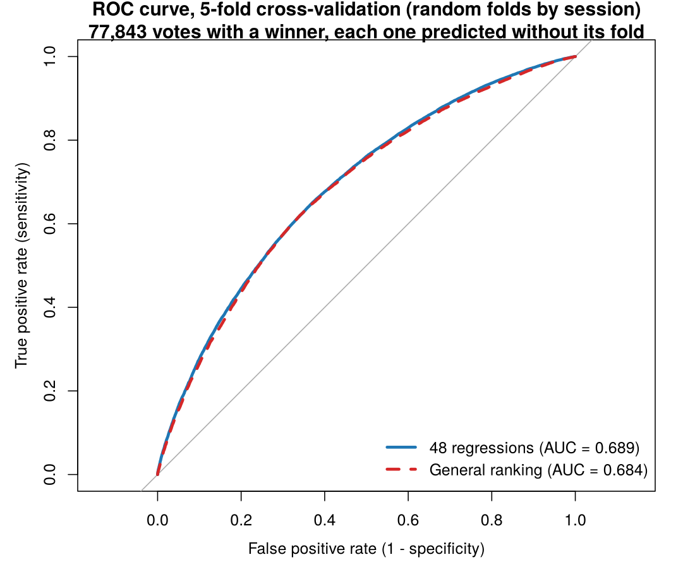

# Which AI model is best for each type of task?

**A team data project in R that uses 135,634 human votes from [LMArena](https://lmarena.ai) to rank AI models by task type, and to recommend the best model for a given question and budget.**

[Project page](https://jfridzon.github.io/Capstone/) · [Technical report](reporte/01_regresiones_48.html) · [Results log](docs/05-resultados.md) · [Method](docs/04-metodo.md)

Business Intelligence Capstone (IDS 3000), Yeshiva University, Sy Syms School of Business. Fall 2026.

---

## The question

Most companies pick one AI model and use it for everything. But models differ: one is stronger at code, another at creative writing, and prices vary a lot. A single general leaderboard hides that.

We use real human judgments to estimate which model is most likely to win on each kind of question, then turn that into a ranking per task and a top 3 within a budget.

## The data

[LMArena](https://huggingface.co/datasets/lmarena-ai/arena-human-preference-140k) shows a person two anonymous AI answers to the same question and asks which is better. The two models are paired at random and their names are hidden until after the vote, so every model sees a similar mix of questions, much like a randomized experiment.

| | |
|---|---|
| Votes | 135,634 (April to July 2025) |
| Models used | 48 (those with 1,000+ votes) |
| Question features | 11 yes/no labels: code, math, creative writing, instruction following, complexity, creativity, domain knowledge, problem solving, real world, specificity, technical accuracy |
| Votes with a clear winner | 77,863 (ties and "both bad" are handled separately) |

The CSV has no conversation text, only vote metadata. See [`data/README.md`](data/README.md) and [`docs/03-datos.md`](docs/03-datos.md).

## Method

1. **One logistic regression per model (48 in total).** For each model, the response is whether it won, and the predictors are the 11 question features. Only information known *before* a model answers is used, so answer length or formatting is never a predictor.
2. **Rank by task.** For any combination of features (for example code + math), order the models by their predicted probability of winning.
3. **Compare with a single general ranking** that ignores the task, which is what a standard leaderboard does.
4. **Check with a combined Bradley-Terry model**, the standard model for paired comparisons, with question features as covariates.

Details and the reasoning behind each decision: [`docs/04-metodo.md`](docs/04-metodo.md) and [`docs/12-decisiones-2-11.md`](docs/12-decisiones-2-11.md).

## Results so far

Evaluated with AUC (computed with the `pROC` package), per vote, against the general ranking:

| Evaluation | Task-aware regressions | General ranking | Difference |
|---|---|---|---|
| All data (77,843 votes with a winner) | 0.7005 | 0.6854 | +0.0151 |
| 5-fold cross-validation, mean (folds split by session) | 0.6894 | 0.6843 | +0.0050 |

The task-aware regressions beat the general ranking in every fold, by a small margin. On the held-out month of July, they also pick the winner slightly more often (65.1% against 64.5%, 20,416 votes). The gain is modest because a few top models do well on almost every task, which is why the second deliverable matters: a top 3 per task that also accounts for price.



Full tables, caveats and per-model results: [`docs/05-resultados.md`](docs/05-resultados.md). Known limits: voters are the general public and not company employees, the data ends in July 2025, and people tend to prefer longer answers (61.8% of decisive votes).

## Status

- [x] Data cleaning and the 48 per-model regressions
- [x] Evaluation: train/test, random 5-fold cross-validation and AUC with `pROC`
- [x] Price table and top 3 per task within a budget
- [x] First version of the interactive app ([`app/app.R`](app/app.R), Shiny)
- [ ] Combined Bradley-Terry comparison
- [ ] Final app, dashboards, report and presentation (November and December 2026)

## Repository layout

```
R/            analysis scripts, run from the repo root; outputs in R/resultados/
app/          Shiny app: pick a task and a budget, get the top 3 models
data/         lmarena_votes.csv (135,634 votes) and its description
docs/         project documentation (in Spanish, see below)
reporte/      technical report in R Markdown, with a rendered HTML version
entregas/     deliverables already submitted, kept as sent
projects/     summary of the project proposal
```

## Reproduce it

Requires R and RStudio (open `Capstone.Rproj`). The raw data is downloaded from Hugging Face and turned into `data/lmarena_votes.csv` by `R/lmarena_tests.R`; the CSV is already in the repo.

```r
source("R/02_regresiones_por_modelo.R")   # the 48 regressions and top-3 ranking function
source("R/11_auc_proc.R")                 # AUC with pROC, all data and 5-fold CV (needs pROC)
```

## Team

| | |
|---|---|
| [Jaime Fridzon](https://github.com/jfridzon) | Project lead and coordination |
| [Mark Benzaquen](https://github.com/markbzq) | Evaluation and AUC |
| [Nessim Betesh](https://github.com/NDB13) | Data preparation and regressions |
| [Marco Fnounou](https://github.com/marcofnounou-bit) | Prices, budget top 3 and the app |
| [Eli Wulfsohn](https://github.com/eliwulfsohn03) | Context checks and charts |

Data: LMArena `arena-human-preference-140k`, prompts under CC-BY-4.0. Parts of the analysis code were written with AI assistance and are labeled as such in the scripts.

---

# Guía del equipo (en español)

Este repo es el contexto compartido del equipo (5 integrantes) y de las IAs que cada uno use (Claude, ChatGPT, etc.). Es la fuente única de verdad: cualquier IA puede leerlo y partir de ahí. **Curso:** IDS 3000 Business Intelligence Capstone, Prof. Avi Giloni.

## Por dónde empezar

Si eres una persona o una IA que llega nueva al proyecto, lee en este orden:

| # | Archivo | Qué tiene |
|---|---|---|
| 0 | [`AGENTS.md`](AGENTS.md) | **Reglas para las IAs** (y para todos). Léelo antes de tocar nada |
| 1 | [`docs/01-contexto.md`](docs/01-contexto.md) | El proyecto completo: problema, cliente, idea, estado actual |
| 2 | [`docs/02-curso-y-requisitos.md`](docs/02-curso-y-requisitos.md) | Qué pide el curso, cómo se evalúa, calendario |
| 3 | [`docs/03-datos.md`](docs/03-datos.md) | El dataset: de dónde viene, cómo se recolectó, columnas, reglas de limpieza |
| 4 | [`docs/04-metodo.md`](docs/04-metodo.md) | Cómo hacemos la predicción: respuesta, predictores, modelos, prueba |
| 5 | [`docs/05-resultados.md`](docs/05-resultados.md) | Todos los números que ya tenemos |
| 6 | [`docs/06-historial-y-profesor.md`](docs/06-historial-y-profesor.md) | Cronología del proyecto, lo que se le mandó al profesor y lo que pidió |
| 7 | [`docs/07-pendientes-y-roles.md`](docs/07-pendientes-y-roles.md) | Quién hace qué y qué falta decidir |
| 8 | [`docs/08-como-trabajar-en-el-repo.md`](docs/08-como-trabajar-en-el-repo.md) | Ramas, pull requests, permisos |

Los documentos más recientes (decisiones del 2/11, fase 2b) están en `docs/12` a `docs/14`.

## Cómo usar este repo (humanos e IA)

1. Clona el repo o descárgalo.
2. Antes de pedirle algo a tu IA, dale `AGENTS.md` y `docs/01-contexto.md` como contexto, más el documento de `docs/` que tenga que ver con tu tarea. Así no se repite trabajo ni se contradice lo que ya está.
3. **No se escribe directo en `main`.** Crea una rama (`tunombre/tema`), haz tus cambios ahí y abre un pull request. Lo aprueba uno de los responsables (Mark, Nessim o Jaime). Ver `docs/08`.
4. No borres lo que ya está. Si algo contradice lo existente, deja una nota explicando el cambio en vez de sobrescribir en silencio.
5. Haz commits con un mensaje claro de qué agregaste y de qué conversación o fecha viene.
6. Este repo es **público**: nada de datos personales, notas, contraseñas ni API keys.
